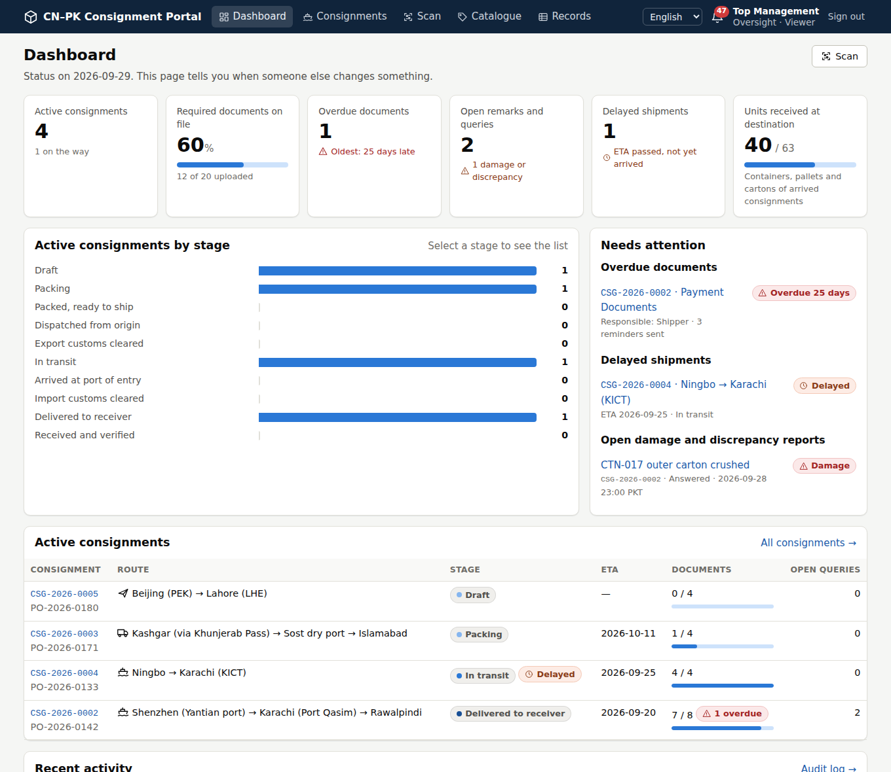

# supplychainsw: CN–PK Consignment Portal

A shared portal for a China → Pakistan supply chain. The **Shipper** (China), the **Receiver**
(Pakistan) and **Oversight** (top management) use it to track consignments down to the individual
item, exchange documents, and raise and resolve issues. It works in **English, 简体中文 and اردو**.

This repository contains:

1. **A critical evaluation of the original proposal**, with a recommended design:
   [docs/01-critical-evaluation.md](docs/01-critical-evaluation.md)
2. **A working prototype** implementing that design (Django, PostgreSQL, Docker), with demo data
   based on the 57-carton / 40 × DCJM example.
3. **A step-by-step plan to develop and deploy** it:
   [docs/03-delivery-plan.md](docs/03-delivery-plan.md)
4. **A tested deployment kit and runbook** (HTTPS, backups, restore):
   [docs/04-deployment-guide.md](docs/04-deployment-guide.md)
5. **A one-click desktop program** (Windows, macOS, Linux) that runs the whole portal on one
   computer, and a guide to giving the Shipper and Receiver access to it:
   [docs/05-run-on-your-computer.md](docs/05-run-on-your-computer.md)



## What it does

- **Item-level traceability.** Consignment `CSG-2026-0042`, unit `CSG-2026-0042-CTN-017` and item
  `CSG-2026-0042-DCJM-017` are generated automatically. IDs never contain the current carton; the
  location is a record, and every move, split and receipt is logged. Units nest to any depth:
  container/truck › pallet › crate › carton › inner box › item.
- **Layer-by-layer map.** Every item and unit shows its full chain (container › pallet › carton ›
  item) with the neighbours at each layer. A nested packing view covers the whole consignment.
- **QR labels.** Package labels are 100×150 mm and item labels 50×30 mm. Scan with a phone camera or
  a handheld scanner to look up, move or receive. Shipper packing lists can be imported from
  Excel/CSV, and packing lists are generated from the data.
- **Milestones and documents.** 11 milestones, each recorded by the party that owns it. Required
  documents depend on the transport mode (B/L, AWB or road note), and controlled items automatically
  add export-licence and end-user NOC requirements. Every upload is versioned and SHA-256
  fingerprinted, and nothing is deleted.
- **Reminders that escalate.** Missing documents trigger a reminder, a second reminder, then an
  escalation to Oversight, by e-mail, in-app and WeCom.
- **Tags and status updates.** The Shipper, the Receiver and Oversight tag a consignment Delayed
  (with a revised ETA), On hold or Priority, and post dated status updates. Tags show next to the
  status on every list and dashboard; delay tags clear themselves when the goods arrive.
- **Remarks and queries.** Either party raises damage, discrepancy, payment or document issues and
  follows them through open › answered › resolved. Remarks can be machine-translated, with the
  original always shown.
- **Three languages.** The whole interface is translated (Urdu right-to-left with a Nastaliq font).
  Each user's own time zone is shown on every timestamp.
- **Oversight.** Dashboard with KPIs, stage chart and a needs-attention list; read-only data tables
  with CSV export; a hash-chained audit log. Oversight managers can also require documents and tag
  consignments.
- **Security.** Organisation × access-level roles with ownership and custody rules, two-factor login,
  lock-out, strict security headers, and no third-party CDNs (important for access from China).

## Run it on your own computer

1. Download the ready-made program:
   - on GitHub, open **Actions › Desktop app**, pick the latest green run, and download the artifact
     for your system from **Artifacts**;
   - or, once a version tag exists, download it from **Releases**.
2. Unzip it and double-click **`CNPK-Portal.exe`** (Windows) or **`CNPK-Portal`** (macOS and Linux).
   You need no Python, Docker or installer.

The browser opens a one-time set-up page. There you create your administrator account and
name the three organisations. On the **People** page you then add people; each one gets a
ready-to-send sign-in message in their own language.

- **Colleagues in the same office:** tick one box to let them connect.
- **The Shipper and Receiver elsewhere:** share the portal over the internet with Cloudflare Tunnel,
  which the program runs itself: a temporary address in one click, or your own address.
- **The demo:** `Start demo` opens the 57-carton example on a separate practice copy.

The steps, backups, security checklist and the limits of hosting on a PC are in
[docs/05-run-on-your-computer.md](docs/05-run-on-your-computer.md).

From the source code:

- Windows: `Start-Portal.bat`.
- macOS and Linux: `./start-portal.sh`.
- Both need Python 3.11 or newer.

## Try the demo from the source code (developers)

```bash
python -m venv .venv && . .venv/bin/activate
pip install -r requirements-dev.txt
cd src && export DJANGO_DEBUG=1
python manage.py migrate && python manage.py seed_demo
python manage.py runserver        # open http://127.0.0.1:8000
```

The desktop program's demo is `CNPK-Portal --demo`.

Demo users (password `Demo-Portal-2026`):

| Username | Role | Language |
|---|---|---|
| `shipper.manager` / `shipper.ops` | Shipper | 中文 |
| `receiver.manager` | Receiver | English |
| `receiver.ops` | Receiver | اردو |
| `oversight` | Oversight (read-only) | English |
| `admin` | System administrator (`/admin/`) | English |

Look at `CSG-2026-0002`: 57 cartons on 5 pallets in container MSKU1234565, with 40 × DCJM in
CTN-001…003 and DCJM-017 moved at export inspection. Its payment documents are overdue and
escalated, and CTN-017 arrived damaged.

## Production

Follow [docs/04-deployment-guide.md](docs/04-deployment-guide.md). In short:

```bash
cd deploy && cp .env.example .env    # fill in domain and secrets
docker compose up -d --build
docker compose exec web python manage.py createsuperuser
```

## Repository layout

```
src/                 Django project
  core/              IDs, audit chain, translation, notifications, desktop settings and backups
  accounts/          organisations, profiles, login + 2FA, set-up page, People page
  logistics/         consignments, packing, documents, remarks, scanner, dashboard
  templates/ static/ locale/   UI, CSS/JS (no CDNs), EN / 中文 / اردو catalogues
launcher/            one-click desktop program: launcher, PyInstaller recipe, build script, smoke test
deploy/              docker-compose, Caddy (HTTPS), backup job, .env template
docs/                evaluation, design, delivery plan, deployment guide, desktop guide,
                     SOP demo dataset (sop-demo/)
```

## Development

```bash
cd src && python manage.py test      # 101 tests
ruff check src deploy launcher
python ../deploy/compile_po.py locale   # after editing translations in locale/*/django.po
python launcher/build.py && python launcher/smoke_test.py dist/CNPK-Portal/CNPK-Portal   # desktop program
```

CI (`.github/workflows/ci.yml`) runs lint, migration checks, the tests and a Docker build on every
push. The **Desktop app** workflow (`.github/workflows/desktop.yml`) builds the program for
Windows and Linux (macOS for version tags) and tests each build end to end. A `v*` tag publishes
the zips as a GitHub release.
