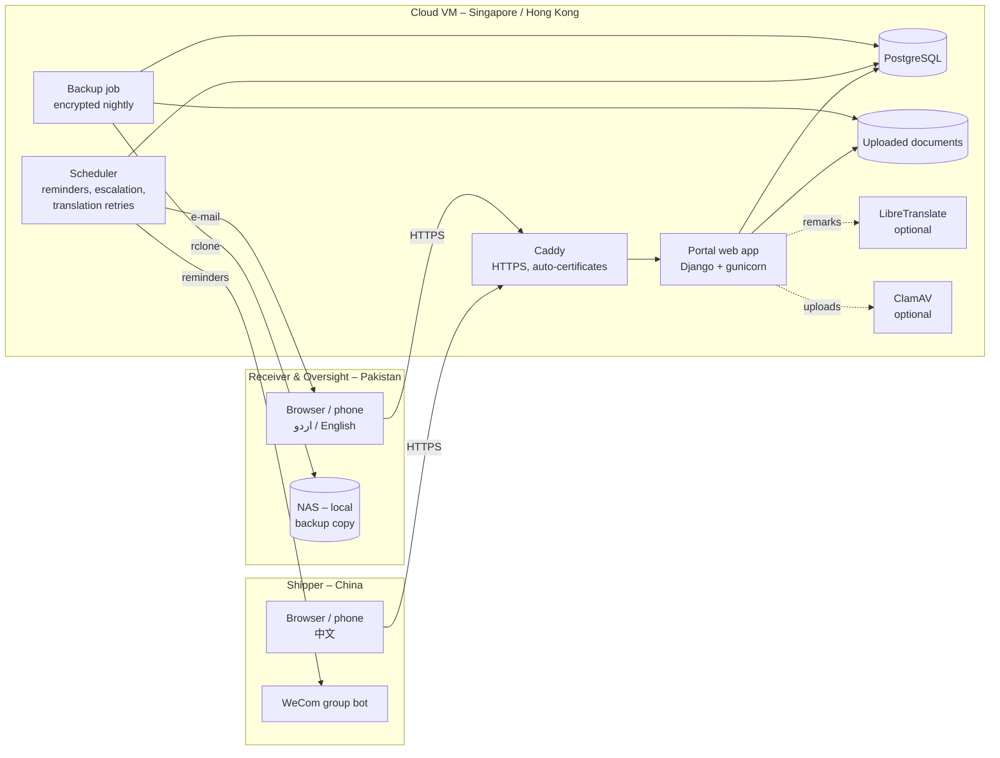
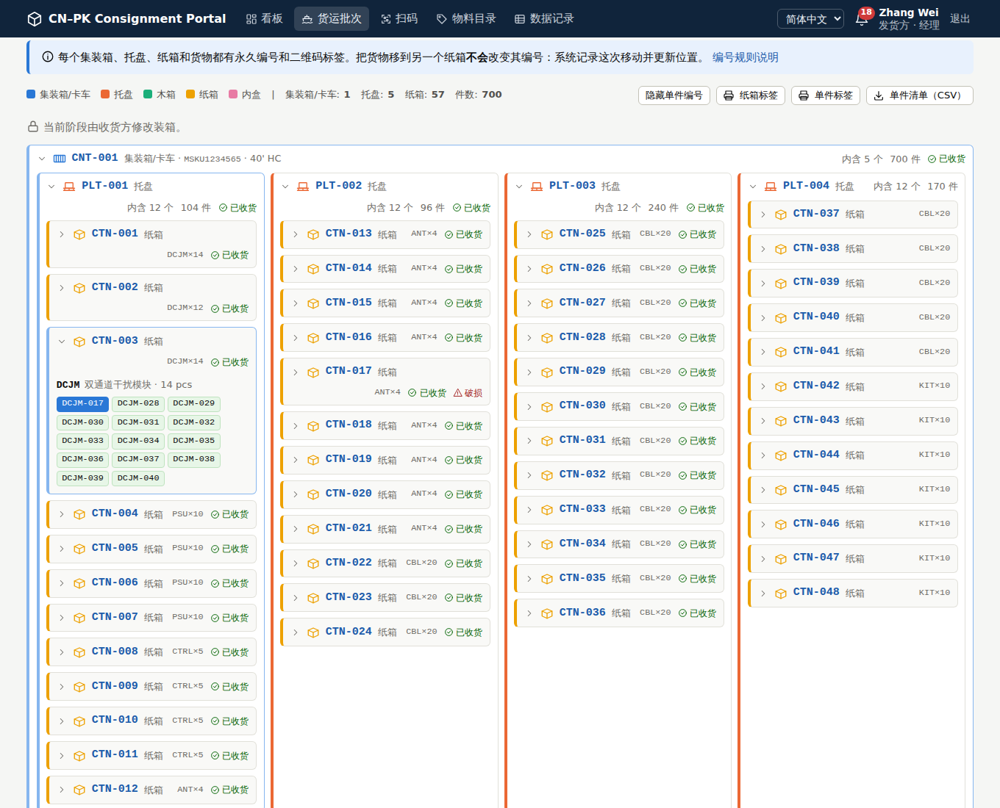
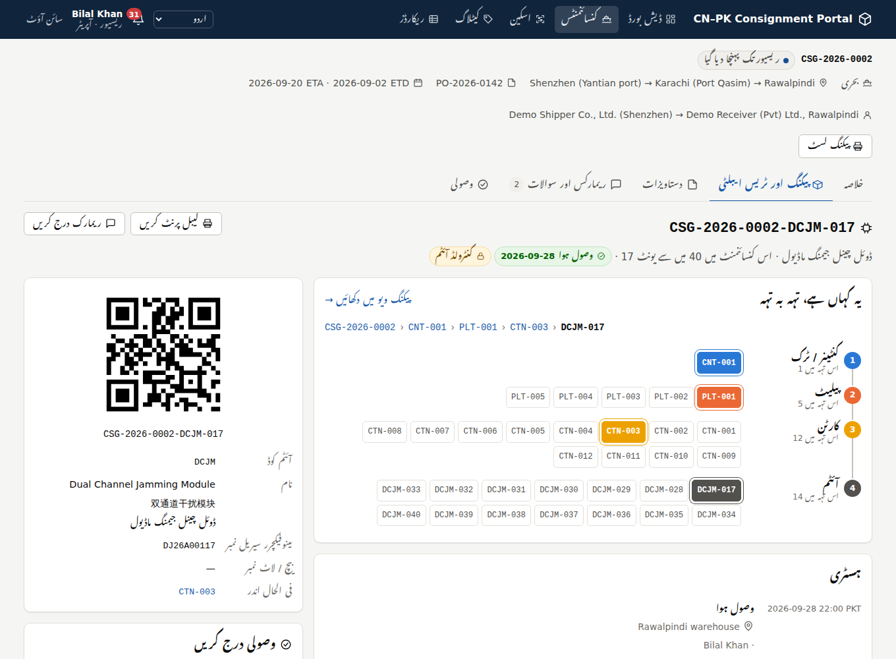
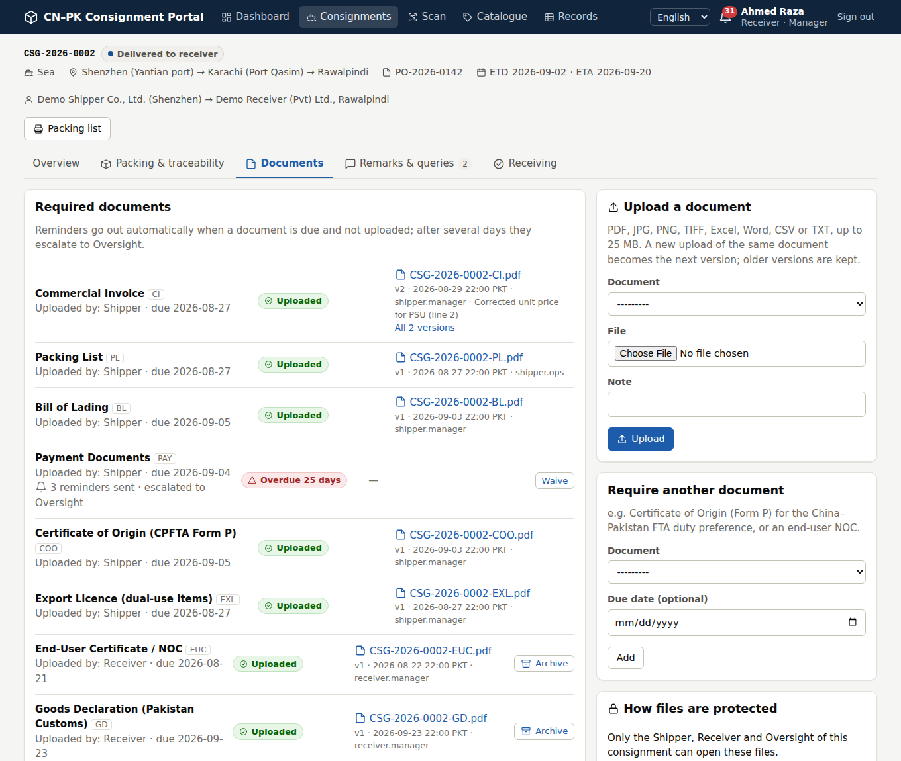
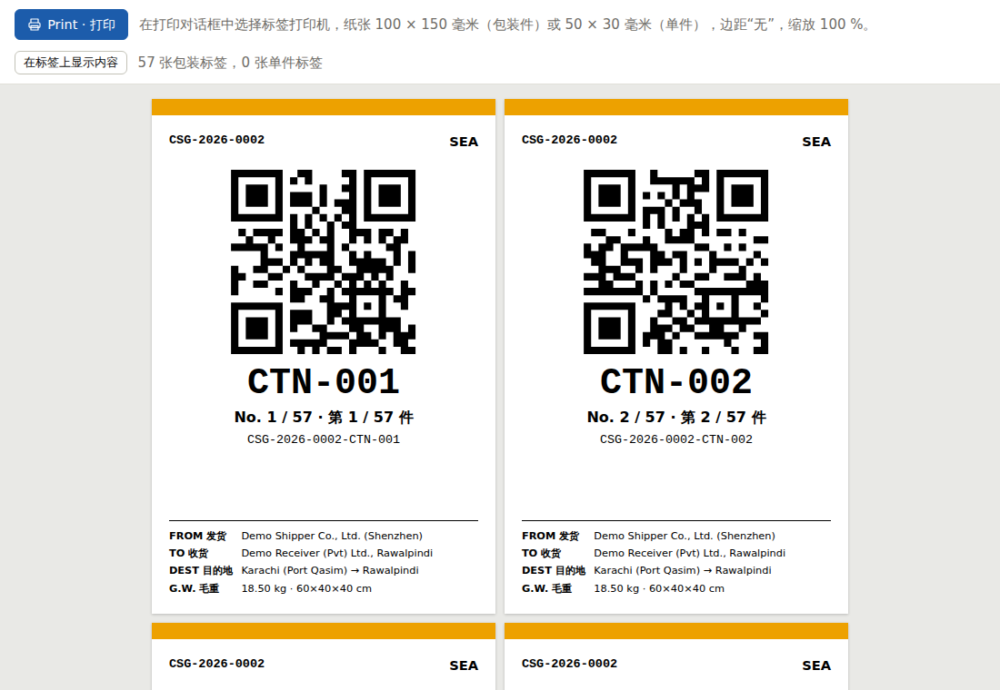
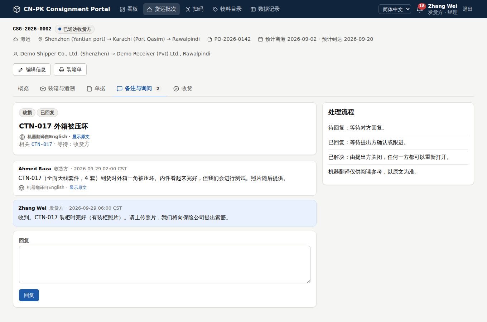

# 2. Solution design (as built in this repository)

The prototype in `src/` implements the recommendations from the
[critical evaluation](01-critical-evaluation.md). It is a working system, not a mock-up. Everything
below runs and is covered by 64 automated tests.

## Architecture

- **One small server** runs everything as Docker containers (see [deploy/](../deploy)).
- **Nothing is loaded from Google, CDNs or third-party fonts**: every script, style and font is served
  by the portal itself, because those services are slow or blocked in mainland China. The Urdu
  Nastaliq font is bundled and only downloaded by Urdu readers.
- **Near real-time:** each page quietly asks the server every 30 seconds whether someone else changed
  something visible on it, and if so offers a refresh. It never reloads while someone is typing.

## Modules

| Area | What it does | Code |
|---|---|---|
| Consignments | Automatic numbers (`CSG-2026-0042`), 11 milestones with owners, ETA-based delay flag, timeline | `logistics/models.py`, `views/consignments.py` |
| Packing & traceability | Containers/trucks, pallets, crates, cartons and inner boxes nested to any depth; serialised items and batch lines; moves, splits and receipts logged as events; layer-by-layer map; nested packing view | `services.py`, `tree.py`, `views/packing.py` |
| Labels | 100×150 mm package labels and 50×30 mm item labels with QR codes, bilingual EN/中文, contents hidden by default | `templates/labels/labels.html`, `static/css/print.css` |
| Packing list | Generated from the packing data (A4, EN/中文) plus a full item CSV with the location path of every item | `views/packing.py`, `reports.py` |
| CSV import | Imports the Shipper's existing Excel packing list (UTF-8 or Chinese GBK); all-or-nothing | `importer.py` |
| Scanner | Phone camera (native detector or bundled decoder), USB/Bluetooth scanners, typing; modes: look up, move/repack, receive | `views/scan.py`, `static/js/scan.js` |
| Documents | Required-document checklist per consignment, set from the transport mode; versions; SHA-256 fingerprints; archive (never delete); optional virus scan | `services.py`, `views/documents.py` |
| Reminders | Due date = milestone + offset; reminder, second reminder, escalation to Oversight; e-mail, in-app and WeCom | `reminders.py`, `core/notify.py` |
| Remarks & queries | Threads with type (remark, query, discrepancy, damage, document, payment), state (open › answered › resolved), link to a unit or item | `views/threads.py` |
| Translation | Complete interface catalogues for EN / 简体中文 / اردو (RTL). Optional machine translation of remarks via LibreTranslate or the Claude API | `locale/`, `core/translation.py` |
| Oversight | Dashboard (KPIs, stage chart, needs-attention list, activity), read-only data explorer with CSV export, audit log | `views/dashboard.py`, `views/records.py` |
| Security | Organisation × access level, ownership and custody rules, TOTP two-factor login, lock-out, hash-chained audit log, strict security headers | `permissions.py`, `accounts/`, `core/audit.py` |

## Identifiers

| Object | Example | Rule |
|---|---|---|
| Consignment | `CSG-2026-0042` | prefix-year-sequence; issued when the consignment is created |
| Unit | `CSG-2026-0042-CTN-017` | `CNT` container/truck, `PLT` pallet, `CRT` crate, `CTN` carton, `BOX` inner box |
| Item | `CSG-2026-0042-DCJM-017` | item-master code + number within the consignment; manufacturer serial stored alongside |

- The QR code contains only the ID. The scanner also accepts short IDs (`CTN-017`) within a
  consignment, manufacturer serial numbers, lower-case input, and full-width characters typed through
  a Chinese input method (`ＣＳＧ－２０２６…`).
- Container numbers are checked against the ISO 6346 check digit, which catches typos in
  `MSKU1234565`.
- Nesting rule: a unit may only go inside a bigger kind (box < carton < crate < pallet < container).
  This keeps the hierarchy sensible and makes loops impossible.

## Who may do what

| Action | Shipper Manager | Shipper Operator | Receiver Manager | Receiver Operator | Oversight | Viewer (any org) |
|---|---|---|---|---|---|---|
| See own consignments | ✓ | ✓ | ✓ | ✓ | all | ✓ |
| Create consignment, edit header | ✓ | ✓ | – | – | – | – |
| Record milestones | up to "in transit" | up to "in transit" | from "dispatched" onwards | from "dispatched" onwards | – | – |
| Pack / move / repack | while the Shipper holds the goods | same | once arrived | same | – | – |
| Receive (scan in, mark damage) | – | – | ✓ | ✓ | – | – |
| Upload documents | Shipper-owned types | same | Receiver-owned types | same | – | – |
| Archive a document | own uploads | – | own uploads | – | – | – |
| Add or waive required documents | ✓ | – | ✓ | – | – | – |
| Raise / answer remarks | ✓ | ✓ | ✓ | ✓ | – | – |
| Resolve a remark | if raised by own org | same | if raised by own org | same | – | – |
| Item master | ✓ | – | ✓ | – | – | – |
| Audit log | ✓ | – | ✓ | – | ✓ | – |

Nothing is ever hard-deleted from the portal. A system administrator (Django admin, `/admin/`)
manages organisations, users and document types. The audit log is read-only even for the administrator.

## Document catalogue (defaults, all configurable)

| Code | Document | Uploaded by | Required by default | Due |
|---|---|---|---|---|
| CI | Commercial Invoice | Shipper | yes | when packed |
| PL | Packing List | Shipper | yes | when packed |
| BL / AWB / RCN | Bill of Lading / Air Waybill / Road consignment note or TIR | Shipper | yes, matching the mode | 1–3 days after departure |
| PAY | Payment documents | Shipper (as specified; consider the payer) | yes | 7 days after dispatch |
| COO | Certificate of Origin (CPFTA Form P) | Shipper | on request | 3 days after departure |
| EXL | Export licence (dual-use) | Shipper | automatic for controlled items | when packed |
| EUC | End-user certificate / NOC | Receiver | automatic for controlled items | before packing |
| INS | Insurance certificate | Shipper | on request | at dispatch |
| FI | Financial Instrument (PSW) | Receiver | on request | at dispatch |
| GD | Goods Declaration (Pakistan Customs) | Receiver | on request | 3 days after arrival |
| GRN | Goods Received Note | Receiver | on request | 2 days after delivery |

Reminder ladder: on the due date, then +2 days, then +5 days, when the matter is escalated to
Oversight. The offsets are configurable in `.env`.

## Screens

| | |
|---|---|
|  Oversight dashboard |  Nested packing view, DCJM-017 highlighted |
|  Item page, layer-by-layer map, Urdu (RTL) |  Required documents, versions, escalation |
|  Package labels (100×150 mm) |  An English damage report read in Chinese |

## Deliberately not in the prototype (see the delivery plan)

- Allocation of items to end users and dispatch to them, with an NOC check.
- WhatsApp Business notifications.
- An offline-capable phone app (PWA) for scanning without signal.
- Automatic container and vessel tracking from carrier APIs.
- Photo attachments on damage reports.
- GS1-compliant identifiers (the ID generator is isolated in `core/ids.py`, so it can be swapped).
