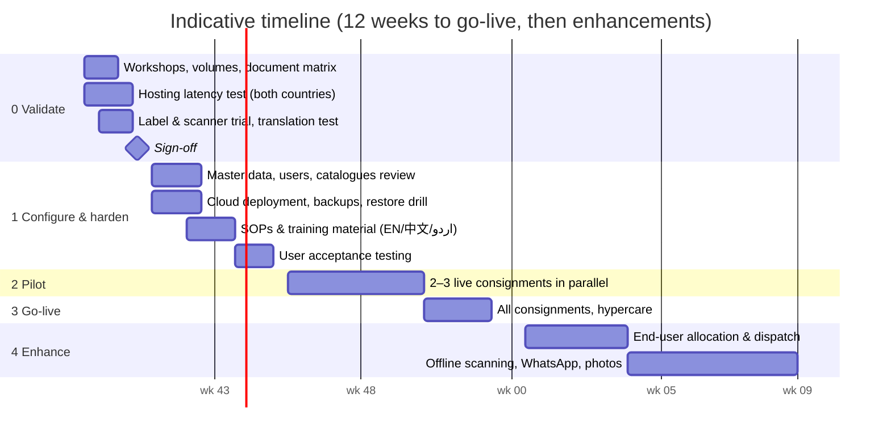

# 3. Step-by-step plan to develop and deploy

The prototype in this repository covers most of the "develop" work already. What remains is
**validating it with the three parties, configuring it with real master data, hosting it securely,
piloting it on live consignments, and then extending it** (end-user allocation first).

## Phase 0: Validate and decide (weeks 1–2)

| Step | What | Output |
|---|---|---|
| 0.1 | Kick-off with Shipper, Receiver and Oversight. Walk through the [evaluation](01-critical-evaluation.md) and demo the prototype with the seeded data (the 57-carton example). | Agreement on the approach; list of objections |
| 0.2 | Map the real process: who packs, where repacking happens (export inspection, Pakistan customs examination), who clears customs, who pays. | As-is / to-be process map |
| 0.3 | Collect volumes: consignments per month, cartons and items per consignment, share of sea / air / road. | Sizing |
| 0.4 | Decide the **document matrix**: which documents, who owns each (especially payment proof), when each is due, reminder offsets. | Configuration workbook |
| 0.5 | Build the **item master**: codes (`DCJM`, …), names in English, Chinese and Urdu, HS codes, serialised or batch, controlled or not. | Item master sheet |
| 0.6 | **Compliance check** with the export agent (China) and customs agent (Pakistan): licences, end-user certificates, NOCs needed for each controlled item. | Document requirements per item type |
| 0.7 | **Hosting test:** small VMs in Singapore, Hong Kong (and Dubai); both offices measure page load and upload time at peak hours for a week. | Region decision |
| 0.8 | **Label and scanner trial:** print 20 labels of each size on the chosen thermal printers; scan with phones and a handheld scanner in both warehouses; check the labels survive handling. | Hardware list |
| 0.9 | **Translation test:** run 30 real past remarks through LibreTranslate and the Claude API; native speakers score them. | MT provider decision (or none) |

**Gate:** Oversight signs off the configuration workbook, hosting region, hardware list and budget.

## Phase 1: Configure and harden (weeks 3–6)

| Step | What |
|---|---|
| 1.1 | Deploy to the chosen region by following [04-deployment-guide.md](04-deployment-guide.md): HTTPS, 2FA enforced, SMTP with SPF/DKIM, WeCom bot for the Shipper's group. |
| 1.2 | Set up **backups**: encrypted nightly archive, off-site copy to the Oversight NAS, then a **restore drill** to a scratch server. |
| 1.3 | Load organisations, users (language + time zone each), item master, document types and offsets. |
| 1.4 | Native speakers review the Chinese and Urdu interface text (about 3 hours each; the files are `src/locale/*/django.po`). |
| 1.5 | Adjust label templates to the printers and add the logo; set the consignment prefix if `CSG` is not wanted. |
| 1.6 | Write bilingual **SOPs**: packing and labelling; "no scan, no move" for repacking; receiving and damage reporting; document upload; raising remarks. One page each, with screenshots. |
| 1.7 | **User acceptance test** with each party, following a script: create consignment › import packing list › print labels › move an item › dispatch › upload documents › arrive › receive by scanning › report damage › resolve › close. |

**Gate:** UAT passed and restore drill passed.

## Phase 2: Pilot (weeks 7–10)

- Run **2–3 live consignments** in the portal *in parallel* with the current email and chat process.
- Weekly 30-minute review with Oversight on the dashboard. Pilot targets:
  - ≥ 95 % of item IDs scanned at receiving;
  - 100 % of required documents uploaded or formally waived before closing;
  - every remark answered within 2 working days;
  - no discrepancy left unresolved for more than 7 days.
- Fix what the pilot reveals: labels, offsets, wording, missing document types.

**Gate:** pilot targets met on at least two consignments.

## Phase 3: Go-live (weeks 11–12)

- All new consignments go through the portal. Email and chat remain for urgent conversation only;
  decisions are recorded in the portal.
- Train new users, then two weeks of hypercare (daily check of the needs-attention list).
- Handover: admin guide, runbooks, support contact and response times.

## Phase 4: Enhancements (months 4–6, in priority order)

1. **End-user allocation and dispatch.** Reserve item IDs for an end user or order; block dispatch of
   controlled items unless that end user's NOC is on file; print a delivery note; scan at dispatch;
   record the end user's acknowledgement. This closes the "right item to the right end user" loop.
2. **Offline scanning** (installable phone app) for warehouses and ports with poor signal.
3. **WhatsApp Business notifications** for the Pakistani side.
4. **Photo evidence** on damage and discrepancy reports (for insurance claims).
5. **Carrier tracking**: vessel, flight and container events update ETA automatically.
6. **Monthly lane report** (PDF) for top management.
7. Accounting link (invoice value, payment status), and GS1 identifiers only if end users require them.

## Operate (ongoing)

| Frequency | Task |
|---|---|
| Daily (automatic) | Encrypted backup + off-site copy; reminders every 15 minutes |
| Monthly | Restore drill; apply Django LTS / OS security updates; review failed logins |
| Quarterly | Access review (leavers removed); `verify_audit`; KPI review with Oversight; translation catalogue update |
| Yearly | Security review / penetration test; review the hosting region and costs |

## Who does what (RACI)

| Activity | Consultant (project lead) | Developer | Shipper lead | Receiver lead | Oversight | IT / admin |
|---|---|---|---|---|---|---|
| Process & document matrix | A/R | C | C | C | I | – |
| Item master | A | C | R (codes, 中文 names) | R (اردو names) | I | – |
| Compliance requirements | A | – | R (export) | R (import, NOC) | C | – |
| Hosting & security | A | R | – | – | I | R |
| Configuration & releases | A | R | – | – | – | C |
| Translation review | A | C | R (中文) | R (اردو) | – | – |
| SOPs & training | A/R | C | R | R | I | – |
| Pilot KPIs & go-live decision | R | C | C | C | **A** | I |

R = responsible, A = accountable, C = consulted, I = informed.

## Indicative running costs (excluding people)

| Item | Indicative cost |
|---|---|
| Cloud VM, 2 vCPU / 4 GB (Singapore or Hong Kong) | ~US$20–40 per month (8 GB, ~US$40–80, if LibreTranslate is self-hosted) |
| Off-site backup storage | ~US$1–5 per month |
| NAS at the Oversight office (2 disks, mirrored) | ~US$300–600 one-off |
| Domain and transactional e-mail | ~US$15 per year + US$0–20 per month |
| Claude API for remark translation (if chosen) | about 1–2 US cents per remark, i.e. a few dollars per month at this volume |
| Thermal label printers (one per warehouse) | ~US$150–600 each; labels ~US$0.01–0.05 each |
| 2D scanners (or staff phones) | ~US$30–150 each |

These are rough market ranges for budgeting; get local quotes.
