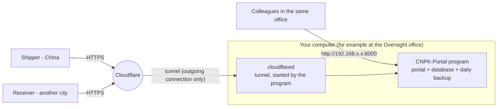
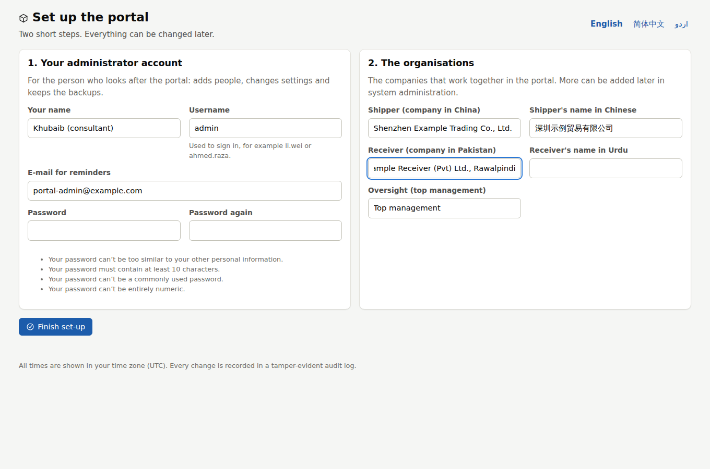
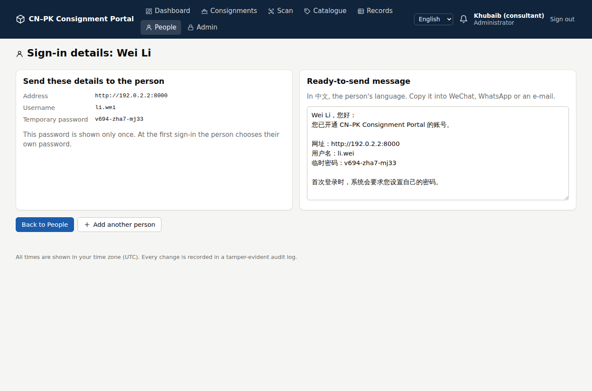
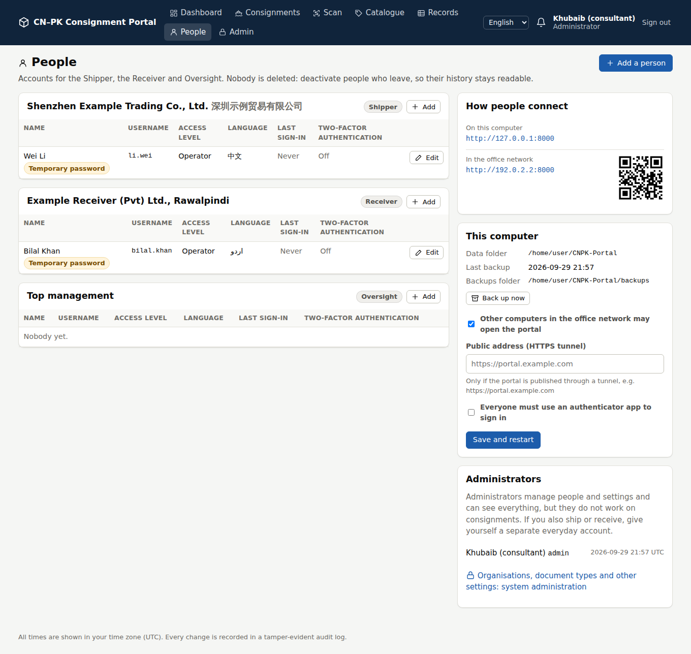

# 5. Running the portal on your own computer

This guide answers three questions:

1. **How do I run the portal locally?** Download the ready-made program `CNPK-Portal`, unzip
   it and double-click it. You need no Python, no Docker and no installer.
2. **Can I host it on my computer and give the Shipper and Receiver access?** Yes:
   - colleagues in the same office connect through the office network;
   - people in other cities or countries connect through a secure tunnel (Cloudflare Tunnel,
     built into the program).

   There is one real limit. A computer in an office is less reliable than a small cloud server,
   and access from mainland China through a tunnel can be slow. Test it from the Shipper's
   office before you rely on it (see [When to move to a cloud server](#when-to-move-to-a-cloud-server)).
3. **Is there a one-click program?** Yes: `CNPK-Portal.exe` on Windows, and `CNPK-Portal` on
   macOS and Linux. It starts the portal and its database, opens your browser, sends the
   reminders and makes a backup every day.



---

## 1. Start the program

### Download

The program is built automatically by GitHub every time the code changes:

1. Open the repository on GitHub, then **Actions**, then **Desktop app**, and click the latest run with a
   green tick.
2. Under **Artifacts**, download **`CNPK-Portal-1.3.0-windows-x64`**. On a Mac or Linux PC,
   download the matching `package-…` file instead.
3. On Windows, first right-click the downloaded zip, choose **Properties**, tick **Unblock** and
   click **OK**. This avoids a security prompt for every file.
4. Unzip it to a simple place, for example `C:\CNPK-Portal`.

Artifacts are deleted after 7 days (30 for a release). For a permanent download page, publish a release:

1. On GitHub, open **Releases › Draft a new release**.
2. Under **Choose a tag**, type `v1.3.0` and pick **Create new tag**. Keep **Target** on `main`.
   The tag must be `v` plus the `VERSION` in `src/config/__init__.py`; otherwise the build stops.
   For the next version, change `VERSION` first (for example to `1.4.0`) and merge that into `main`.
3. Click **Publish release**.

A few minutes later, zips for Windows, macOS and Linux are attached to the release. The macOS
version is only built for releases, or when you start the **Desktop app** workflow by hand
(**Run workflow**).

### First start

1. Double-click **`CNPK-Portal.exe`**.
   - Windows may say *"Windows protected your PC"*, because the program is not code-signed.
     Click **More info**, then **Run anyway**.
   - On a Mac the first time, right-click `CNPK-Portal`, choose **Open**, then **Open**.
2. A window opens with the portal's addresses:

   ```
   ============================================================================
   CN-PK Consignment Portal   (version 1.3.0)

     On this computer:   http://127.0.0.1:8000

     Data folder:        C:\Users\Khubaib\CNPK-Portal
     Only this computer can open the portal (start with --network to allow the office network).

     FIRST START: open this link to set up the portal (it works only once):
     http://127.0.0.1:8000/setup/?token=q8Rk2mZt5LwX1vN9cH4pJ7sD0fB3gY6a

     Keep this window open while people use the portal.
     To stop the portal, close this window or press Ctrl+C.
   ============================================================================
   ```

   Your browser then opens the **set-up page**:
   - **Your administrator account.** This is for the person who looks after the portal. Choose
     a strong password.
   - **The organisations.** Enter the names of the Shipper, the Receiver and Oversight. The
     Shipper's language and time zone are set to Chinese and China time.

   
3. Click **Finish set-up**. You arrive on the **People** page.

> The set-up link contains a one-time key and is shown only in the program window. Someone
> else on the network cannot set up your portal before you do.

**Keep the window open** while people use the portal. Closing the window (or pressing Ctrl+C)
stops the portal.

### Add the people who will use it

On **People**, click **Add a person** and fill in:

- name and username;
- organisation;
- access level (Manager, Operator or Viewer);
- optionally an e-mail address for reminders.

Language and time zone follow the organisation unless you change them. The portal then shows:

- the **sign-in details**, with a temporary password that is shown only once;
- a **ready-to-send message in the person's own language** (Chinese for the Shipper, English or
  Urdu for the Receiver). Copy it into WeChat, WhatsApp or an e-mail.



At first sign-in each person chooses their own password. The People page also resets
passwords, resets two-factor authentication after a lost phone, and deactivates people who leave.
Nobody is deleted, so the history stays readable.

### Try the demo first (optional)

Double-click **`Start demo`** (Windows: `Start demo.cmd`). It opens a separate practice copy with
the 57-carton example on port 8001. Your real data is not touched.

- Users: `shipper.manager`, `shipper.ops`, `receiver.manager`, `receiver.ops`, `oversight` and `admin`.
- Password for all of them: `Demo-Portal-2026`.
- To start the demo again from scratch, run `CNPK-Portal --demo --fresh`.

---

## 2. Giving the Shipper and Receiver access

| Who needs access | How | Effort | Notes |
|---|---|---|---|
| People in the **same office or building** | Turn on network access | 2 minutes | Plain HTTP inside the office network. Fine on a private office network with strong passwords; never on public Wi-Fi. |
| People in **other cities or countries** (Shipper in China, Receiver's warehouse) | **Cloudflare Tunnel**, built into the program | 1 minute with a temporary address; 30 minutes for your own address (needs a domain name, about US$10 a year) | HTTPS; no open ports on your router; your office IP address stays private; works behind the carrier-grade NAT common on Pakistani connections. |
| A few trusted people with laptops | Tailscale (private network) | 10 minutes per person | Encrypted, no domain needed, but every user installs an app, and it is often unreliable from mainland China. |
| Anyone | Port forwarding on the router | Not recommended | Exposes the computer directly to the internet and needs your own HTTPS set-up. Many connections in Pakistan cannot receive incoming connections at all. |

### A. Same office network

1. On **People › This computer**, tick **Other computers in the office network may open the
   portal**, then click **Save and restart**. You can also start the program once with
   `CNPK-Portal --network`; the setting is remembered.
2. When Windows Firewall asks, tick **Private networks** and click **Allow access**. If your
   office network is marked *Public* in Windows, change it to *Private* (Settings › Network &
   internet › your network › Private network).
3. **People › How people connect** now shows the address, for example
   `http://192.168.1.20:8000`, with a QR code that phones can scan.

   
4. Ask whoever manages the router to give this computer a **fixed address** (a *DHCP reservation*).
   Otherwise the address can change after a restart.

### B. From anywhere, with Cloudflare Tunnel (built in)

The program runs Cloudflare's tunnel program, **cloudflared**, by itself. cloudflared connects
*out* to Cloudflare, and Cloudflare serves the portal over HTTPS to people anywhere. Nothing on your
router has to change, and the address of your office stays private. If cloudflared is not
installed on the computer, the portal downloads it the first time (about 55 MB, Cloudflare's own
release on GitHub) into the `tools` folder of the data folder, and checks its checksum.

There are two ways:

| | Temporary address | Own address |
|---|---|---|
| Address | random, e.g. `https://brave-otter-sample-words.trycloudflare.com` | yours, e.g. `https://portal.yourcompany.com` |
| Changes | every time the portal starts | never |
| Needs | nothing | a free Cloudflare account and a domain (about US$10 a year) |
| Good for | trying it out with the Shipper and the Receiver | everyday use |

Cloudflare offers temporary addresses for testing: there is no uptime guarantee, and at most 200
requests can be under way at once.

#### B1. A temporary address (1 minute)

1. Go to **People › This computer**:
   - set **Share over the internet (Cloudflare Tunnel)** to **Temporary address**;
   - tick **Everyone must use an authenticator app to sign in**;
   - click **Save and restart**.

   You can also start the program once with `CNPK-Portal --tunnel`; the setting is remembered.
2. After a few seconds **People › How people connect** shows the address with a QR code. The
   portal window shows it too:

   ```text
   From the internet:  https://brave-otter-sample-words.trycloudflare.com
                       (temporary: a new address every time the portal starts)
   ```

   
3. Send the address to the people who should open the portal. The sign-in messages on the People
   page use it.

The address changes whenever the portal or the computer restarts. Send the new one each time, or
set up your own address (B2).

#### B2. Your own address (30 minutes)

1. Buy a domain, or use one you have, and add it to a free Cloudflare account.
2. In the Cloudflare dashboard open **Zero Trust › Networks › Tunnels**, click **Create a tunnel**,
   choose **Cloudflared** and name it `cnpk-portal`.
3. Cloudflare shows an install command with a long token that starts with `eyJ`. Copy the command,
   or only the token. You do not need to run it: the portal runs cloudflared itself.
4. Add a **public hostname**:
   - subdomain `portal`, your domain;
   - service **HTTP**, URL **`127.0.0.1:8000`**.
5. In the portal, go to **People › This computer**:
   - set **Share over the internet** to **Own address**;
   - paste the token, or the whole command, into **Tunnel token**;
   - enter **Public address** `https://portal.yourcompany.com`;
   - tick **Everyone must use an authenticator app to sign in**;
   - click **Save and restart**.
6. **People › How people connect** shows *Cloudflare Tunnel is connected.* If the public hostname in
   Cloudflare points somewhere else, it says what to change.

Network access can stay off for both ways; the tunnel does not need it.

The token is kept in `settings.ini`, which only your user account and the computer's administrators
can read. It is never shown in
the browser and never written to the audit log. Anyone with the token can connect a computer to
your tunnel, so keep it like a password. If it leaks, refresh it in the Cloudflare dashboard and
paste the new one.

You can instead run cloudflared as a Windows service, so that the tunnel also runs while the
portal is closed. Run Cloudflare's install command in a Command Prompt opened with **Run as
administrator**. In the portal, leave **Share over the internet** on **No** and enter only the
**Public address**.

#### Test from China and from a phone

1. Test from a phone on **mobile data** (not the office Wi-Fi): open the address and sign in.
2. **Test from the Shipper's office in China** for a week, at their busy hours: sign in, open a
   consignment, upload a document.

Without Cloudflare's China Network (an Enterprise plan that needs a Chinese ICP licence), visitors
in mainland China reach Cloudflare through data centres outside the country. Pages can therefore be
slow there, especially in the evening. If they are too slow or do not open, see
[When to move to a cloud server](#when-to-move-to-a-cloud-server).

The portal trusts the tunnel's *"this visitor used HTTPS"* header only when it comes from this
computer itself (where cloudflared runs). The same header from anywhere else is removed.

### C. Tailscale (alternative for a few people)

1. Install Tailscale on the portal computer and on each person's laptop or phone, all signed in
   to the same Tailscale network (or share the computer with them).
2. Turn on network access (step A.1).
3. People open `http://<computer-name>:8000` using the computer's Tailscale name or its 100.x.y.z
   address.

Traffic is encrypted end to end. Do not use this for the Shipper in mainland China, where VPN
apps are restricted.

---

## 3. Keeping it running

A server is only useful if it is on. On the portal computer:

- [ ] **No sleep.** Settings › System › Power › *When plugged in, put my device to sleep*: **Never**.
- [ ] **UPS.** A small UPS (600–1,000 VA) rides through short power cuts during load-shedding.
- [ ] **Restart after a power cut.** In the BIOS, set *Restore on AC power loss* to **Power On**.
- [ ] **Start with Windows.** Run `CNPK-Portal autostart on` once. It starts the portal
      (minimised, without opening the browser) whenever you sign in. For a PC that should come
      back without anyone signing in, see [Unattended start-up](#unattended-start-up) below.
- [ ] **Windows Update.** Set *active hours*, so that restarts happen at night.
- [ ] **Wired network.** Use a cable rather than Wi-Fi for the portal computer.
- [ ] **Antivirus.** If it blocks or quarantines the program, add an exclusion for the program folder.
- [ ] **Hardware.** Any PC from the last 8 years with 4 GB RAM (8 GB is better) and an SSD is enough
      for a few dozen users.

### Unattended start-up

In **Task Scheduler**:

1. Click **Create Task**.
2. General: select **Run whether user is logged on or not**.
3. Triggers: add **At startup**.
4. Actions: **Start a program**:
   - program: `C:\CNPK-Portal\CNPK-Portal.exe`;
   - arguments: `--no-browser`.
5. Conditions: untick *Start the task only if the computer is on AC power*.

The portal then runs without a window. Stop it with `CNPK-Portal stop`.

---

## 4. Your data and backups

All data lives in one folder, **`CNPK-Portal` in your home folder** (for example
`C:\Users\<you>\CNPK-Portal`). The program folder holds none.

| In the data folder | What it is |
|---|---|
| `db.sqlite3` | the database |
| `media\` | uploaded documents |
| `backups\` | a zip made every day, holding the database and all documents. Kept 30 days; the newest 7 are always kept. |
| `settings.ini` | port, network access, tunnel, public address, e-mail, translation (open with Notepad) |
| `logs\` | `portal.log` (what happened, for troubleshooting) and `tunnel.log` (Cloudflare Tunnel) |
| `outbox\` | reminder e-mails, saved here while no mail server is set up |
| `tools\` | cloudflared, if the portal had to download it for Cloudflare Tunnel (about 55 MB) |

- **Disk space.** Every daily backup holds the database and *all* documents, and about 30 are
  kept. The backups therefore need roughly 30 times the space of the documents. If that is too
  much for drive C:, lower `keep_days` in `settings.ini`, or keep the data on another drive.
- **On another drive**, for example D:
  1. Close the portal window and move the `CNPK-Portal` folder to `D:\`.
  2. In a Command Prompt run `setx CNPK_PORTAL_HOME D:\CNPK-Portal` once. From then on the program
     and all its commands use that folder (the demo uses `D:\CNPK-Portal-Demo`).
  3. If the portal starts automatically, open a new Command Prompt and run
     `CNPK-Portal autostart on` again. For the Task Scheduler start-up, add
     `--data-dir D:\CNPK-Portal` to its arguments.

  Instead of step 2 you can add `--data-dir D:\CNPK-Portal` to every command.
- **Back up now:** click **People › This computer › Back up now**, or run `CNPK-Portal backup`.
  Backups are safe to make while people are working.
- **Keep a copy somewhere else.** A backup on the same disk does not survive a disk failure or a
  theft. In `settings.ini`, set `copy_to` to:
  - a USB disk, for example `E:\portal-backups`;
  - a network drive;
  - or a synced cloud folder.

  Each daily backup is then copied there too. The zips are **not encrypted**, so only use cloud
  storage you trust with these documents.
- **Restore:**
  1. Close the portal window.
  2. Run `CNPK-Portal restore C:\Users\<you>\CNPK-Portal\backups\portal-backup-YYYYMMDD-HHMMSS.zip`.
  3. Start the portal again.

  The data that was replaced is kept in a `before-restore-…` folder.
- **Monthly check.** Restore the latest backup on a second computer (or with `--data-dir` into a
  test folder) and sign in.
- **Moving to a new computer:**
  1. Stop the portal.
  2. Copy the whole `CNPK-Portal` data folder to the same place on the new computer.
  3. Unzip the program there and start it.

---

## 5. Security checklist

- [ ] The administrator account has a strong password and is used only for administration. If you
      also ship or receive, give yourself a separate everyday account.
- [ ] Two-factor sign-in is required as soon as the portal is reachable from the internet
      (People › This computer).
- [ ] The portal computer's disk is encrypted (**BitLocker** on Windows Pro, **FileVault** on
      Mac). The database and documents are on it.
- [ ] The Windows account has a password; the screen locks automatically; the computer is in a
      room that is locked at night.
- [ ] Windows is kept up to date, and the portal is updated when a new version comes out.
- [ ] Network access is only used on a private office network, never on public Wi-Fi.
- [ ] Leavers are deactivated on the People page the same day.
- [ ] The tunnel token (own address) is kept like a password, and a temporary address is sent only
      to the people who need it.
- [ ] Backups are copied off the computer (USB disk kept elsewhere, or a trusted cloud folder).

---

## 6. Updating

1. Download the new version.
2. Close the portal window.
3. Replace the program folder with the new one.
4. Start it.

Your data folder is not touched. If the new version changes the database, it makes a backup
first (`…-before-upgrade.zip`) and then upgrades the database.

---

## 7. Settings (`settings.ini`)

Open `settings.ini` in the data folder with Notepad, change a value, save it, and restart the portal.
Administrators can change the first five settings from the People page.

| Setting | Meaning |
|---|---|
| `network_access` | `yes`: other computers in the office network may connect. `no`: only this computer (and the tunnel). |
| `tunnel` | Cloudflare Tunnel: `off`, `temporary` (a temporary trycloudflare.com address) or `token` (your own address). |
| `tunnel_token` | The token of your own tunnel, from the Cloudflare dashboard. |
| `public_url` | Your own HTTPS address, e.g. `https://portal.yourcompany.com`. Links in reminder e-mails use it. |
| `require_two_factor` | `yes`: everyone must use an authenticator app. |
| `port` | Default `8000` (the demo uses `8001`). Change it only if another program uses the port. |
| `keep_days`, `copy_to` | How long backups are kept, and a second folder that receives a copy of each backup. |
| `smtp_host`, `smtp_port`, `smtp_user`, `smtp_password`, `smtp_tls`, `from_address` | Mail server for reminder e-mails, for example your company mail or an e-mail service. |
| `provider`, `anthropic_api_key`, `libretranslate_url` | Machine translation of remarks: `none`, `anthropic` (Claude API) or `libretranslate`. |
| `[advanced]` | Any other setting from `deploy/.env.example`, e.g. `PORTAL_REMINDER_DAYS = 0,2,5`. |

---

## 8. Commands

Run these in a Command Prompt, in the program folder. On Windows, `CNPK-Portal` means
`CNPK-Portal.exe`.

| Command | What it does |
|---|---|
| `CNPK-Portal` | start the portal and open the browser |
| `CNPK-Portal --network` / `--local` | allow / stop access from the office network (remembered) |
| `CNPK-Portal --tunnel` | share the portal over the internet with a temporary address (remembered; `--tunnel token` for your own address, `--tunnel off` to stop) |
| `CNPK-Portal --port 8080` | use another port (remembered) |
| `CNPK-Portal --no-browser` | start without opening the browser |
| `CNPK-Portal --demo` | the practice copy with demo data (`--fresh` starts it again from scratch) |
| `CNPK-Portal backup` | make a backup now |
| `CNPK-Portal restore FILE` | put a backup back (stop the portal first) |
| `CNPK-Portal stop` | stop a portal that runs without a window |
| `CNPK-Portal autostart on` / `off` | start the portal when you sign in to this computer |
| `CNPK-Portal manage changepassword admin` | set a new password for the administrator (if forgotten) |
| `CNPK-Portal --data-dir D:\PortalData` | keep the data in another folder (add it to every command) |

---

## 9. Troubleshooting

| Problem | What to do |
|---|---|
| *"Port 8000 is already used by another program"* | Close the other program, or start with `--port 8080`. |
| *"The portal is already running"* | The browser opens the running portal. Its window may be minimised on the taskbar. |
| Colleagues cannot connect over the office network | Check that network access is on (People › This computer). Check that Windows Firewall allows the program on *Private* networks, and that the network is marked Private. Check the address on People › How people connect. |
| *"Bad Request (400)"* through the tunnel | Enter the tunnel's address as **Public address** on the People page. |
| People › How people connect says *Cloudflare Tunnel is not working.* | The reason is shown below it. Common ones: no internet connection; a firewall that blocks outgoing connections to port 7844 (cloudflared needs it, UDP or TCP); a token that was refreshed in Cloudflare. Details are in `logs\tunnel.log` in the data folder. |
| cloudflared cannot be downloaded | Download `cloudflared-windows-amd64.exe` from Cloudflare's releases on GitHub (github.com/cloudflare/cloudflared/releases) yourself, rename it to `cloudflared.exe` and put it in the program folder. |
| Antivirus or company security software warns about cloudflared | cloudflared is Cloudflare's own program, signed by Cloudflare, Inc. Some security software warns about it because attackers misuse tunnels too. Allow it, or ask your IT staff to. |
| Forgot the administrator password | `CNPK-Portal manage changepassword admin` (use your administrator's username). |
| Someone is locked out after wrong passwords | Wait 15 minutes, or restart the portal. |
| Someone lost the phone with the authenticator app | People › the person › **Reset two-factor authentication**. |
| Something else | Look at `logs\portal.log` in the data folder. |

---

## 10. When to move to a cloud server

Move to a cloud server when any of these happens:

- the Shipper finds the portal slow or unreliable from China after the test week;
- the computer cannot be kept on day and night, or power or internet cuts are frequent;
- more than about 25 people use the portal, or many upload large documents at the same time;
- nobody is available to look after the computer.

Then use the server edition in [04-deployment-guide.md](04-deployment-guide.md): a small VM in
Singapore or Hong Kong, with PostgreSQL, automatic HTTPS and encrypted off-site backups. Your data
comes along:

```bash
# on the portal computer (portal stopped)
CNPK-Portal manage dumpdata --natural-foreign --natural-primary -e contenttypes -e auth.permission -e sessions -e admin.logentry --indent 1 -o portal-data.json
# copy portal-data.json and the data folder's media\ folder to the server, then there:
docker compose cp portal-data.json web:/tmp/portal-data.json
docker compose exec web python manage.py loaddata /tmp/portal-data.json
docker compose run --rm -v "$PWD/media":/restore --entrypoint sh web -c "cp -a /restore/. /data/media/"
docker compose exec web python manage.py verify_audit
```

This was tested with the demo data: all consignments, items, users and the audit chain arrive
intact.

---

## 11. For IT staff

### Run from the source code

This needs Python 3.11 or newer.

- **Windows:** download the repository as a ZIP and double-click **`Start-Portal.bat`**.
- **macOS and Linux:** run `./start-portal.sh`.

The first start installs the required packages from the internet. In mainland China, set a PyPI
mirror first, for example `set PIP_INDEX_URL=https://pypi.tuna.tsinghua.edu.cn/simple`. The
scripts accept the same options as the program, e.g. `Start-Portal.bat --demo`.

### Build the program yourself

```bash
pip install -r launcher/requirements-build.txt
python launcher/build.py                                          # → dist/CNPK-Portal-<version>-<os>.zip
python launcher/smoke_test.py dist/CNPK-Portal/CNPK-Portal        # end-to-end test of the built program
```

A program runs only on the kind of system it was built on. The **Desktop app** workflow
(`.github/workflows/desktop.yml`) builds and tests the Windows and Linux versions on every change,
and the macOS version for tags.

### How it works

- `launcher/portal_launcher.py` starts the portal (Django) with the **waitress** web server in a
  second process and restarts it if it stops or after a settings change.
- It uses **SQLite** in WAL mode. Every commit is written to disk, so a power cut does not
  corrupt the database.
- A background thread sends reminders every 15 minutes and makes the daily backup.
- Before a database upgrade the launcher makes a backup.
- With a tunnel, the launcher also runs **cloudflared** (`src/core/tunnel.py`). It uses an
  installed cloudflared, or downloads the pinned release once and checks its SHA-256 (to move to a
  newer cloudflared, change `VERSION` and the checksums there). It starts cloudflared again if it
  stops and reports its state in `tunnel.json`, which the People page reads. The token reaches
  cloudflared through its environment, never its command line. `CNPK_CLOUDFLARED` names another
  cloudflared to use.
- The code shared with the web interface (settings file, backups, addresses) is in
  `src/core/desktop.py`.
